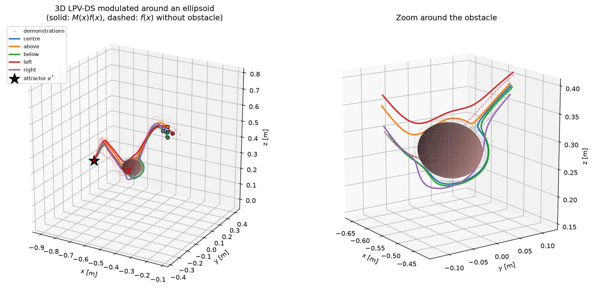

# 3D Obstacle Avoidance with Dynamical Systems

Final lab project for *Robot's Control Architectures* (UC3M).

We learn a stable non-linear dynamical system (LPV-DS) from demonstrations and
modulate it around an obstacle in 3D, so that the robot reproduces the
demonstrated motion, goes around the obstacle and still converges to the target.
At the end, the same controller drives a simulated Franka Emika Panda through its
Jacobian.

<p align="center">
  
</p>

## What's in here

```
ds_learning/
  lpvds.py          LPV-DS: data loading, GMM (EM + BIC), Lyapunov matrix P,
                    SDP for A_k, evaluation and simulation
  obstacle3d.py     Ellipsoid obstacle: Gamma(x), normal, [n, e1, e2] basis,
                    D(x) and M(x) = E D E^-1
train_lpvds.py      learns an LPV-DS from one of the Lab 1 datasets
main_3d.py          MAIN SCRIPT: 3D results of the report
robot_sim.py        Franka Panda following the modulated DS (q_dot = J^+ x_dot_mod)
session2_lpvds_obstacle_2d.py   2D version using the Lab 2 obstacle package
test_modulation.py  numerical checks of the modulation
make_video.py       renders the demo video
lab2_obstacle_package/   Lab 2 package (patched, see its README)
models/             trained models (.json) + the demonstrations used (.npz)
figures/            all figures and videos
report/             report source (LaTeX) and PDF
```

## Setup

You need [Miniforge](https://github.com/conda-forge/miniforge) (or any conda).
From the repo folder:

```bash
conda create -n DS_obstacle_avoidance -c conda-forge python=3.11 pip -y
conda activate DS_obstacle_avoidance
pip install -r requirements.txt
pip install -e lab2_obstacle_package     # Lab 2 package (2D script and video)
```

`lab2_obstacle_package/` is a copy of the Lab 2 obstacle-avoidance code with a few
small fixes (see its README). The 3D part and the robot only use our own code.

We install everything with pip on purpose. On our Windows laptop, Smart App
Control blocked the conda-forge builds of numpy (and also scikit-learn and
SCS from pip), which is why the GMM is written by hand and cvxpy uses the
Clarabel solver.

## Running it

```bash
python main_3d.py              # 3D simulation, prints the metrics, saves figures/
python main_3d.py --animate    # same thing with a live 3D animation
python robot_sim.py            # Franka Panda runs + figures
python robot_sim.py --show     # animated robot
python test_modulation.py      # sanity checks of M(x)
python session2_lpvds_obstacle_2d.py   # 2D (Lab 2 package + learned DS)
python make_video.py           # rebuilds figures/demo_video.mp4 (~2 min)
```

The trained models are already in `models/`. To train them again, you need the
Lab 1 datasets in `../Lab Session 1 Code-20261109/...`:

```bash
python train_lpvds.py --dataset 3D_viapoint_3 --name viapoint3d --nb_traj 6 --eps 0.01 --direction_weight 4
python train_lpvds.py --dataset 2D_Sshape --name sshape2d
```

## How it works (short version)

1. **Nominal DS.** `f(x) = Σ γ_k(x) (A_k x + b_k)`. The weights γ_k come from a
   GMM on the demonstrations. The A_k come from a convex SDP with
   `A_kᵀP + P A_k ≺ 0` and `b_k = -A_k x*`, so `V = (x-x*)ᵀP(x-x*)` is a
   Lyapunov function and every trajectory ends at x*.
2. **Obstacle.** `Γ(x) = Σ (x̃_i / (s_f a_i))²` in the ellipsoid frame,
   `n = ∇Γ/‖∇Γ‖`, completed to an orthonormal basis `[n, e1, e2]`.
3. **Modulation.** `M = E D E⁻¹` with `E = [r e1 e2]` and
   `D = diag(1 - 1/Γ, 1 + 1/Γ, 1 + 1/Γ)`, then `ẋ = M(x) f(x)`. On the
   surface, the component towards the obstacle becomes zero. Far away, M ≈ I.
4. **Robot.** Every 10 ms: `p = FK(q)`, `ẋ_mod = M f`,
   `q̇ = J⁺ [ẋ_mod; ω] + (I - J⁺J) q̇₀` (damped least squares, gripper kept
   vertical, null-space term to stay away from joint limits, Panda velocity
   limits enforced).

The details and results are in `report/report.pdf`.

## Notes

- Only the end-effector avoids the obstacle. The rest of the arm isn't checked
  for collisions.

## References

- S. M. Khansari-Zadeh, A. Billard. *Learning stable nonlinear dynamical systems with Gaussian mixture models.* IEEE T-RO, 2011.
- S. M. Khansari-Zadeh, A. Billard. *A dynamical system approach to realtime obstacle avoidance.* Autonomous Robots, 2012.
- N. Figueroa, A. Billard. *A physically-consistent Bayesian non-parametric mixture model for dynamical system learning.* CoRL, 2018.
- L. Huber, A. Billard, J.-J. Slotine. *Avoidance of convex and concave obstacles with convergence ensured through contraction.* IEEE RA-L, 2019.
- P. Corke, J. Haviland. *Not your grandmother's toolbox: the Robotics Toolbox reinvented for Python.* ICRA, 2021.
- Lab code: `ds-opt` / `phys-gmm` (N. Figueroa, LASA-EPFL) and `dynamic_obstacle_avoidance` (L. Huber, maintained by A. Prados).

**AI use:** we used Claude (Anthropic, via Claude Code) as a coding assistant,
mainly to port the LPV-DS learning from MATLAB, to debug the setup, and for the
plotting/video scripts. All results were checked by us.
